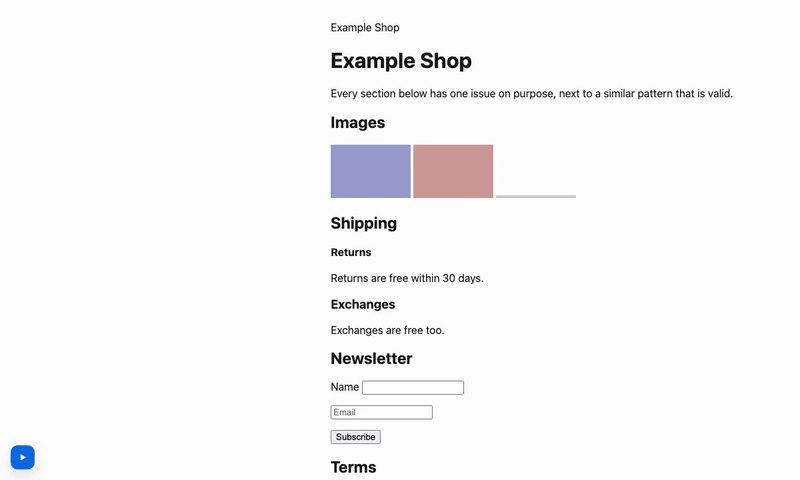

# SAT: SEO Accessibility Tool

**Accessibility and SEO issues on the page in `vite dev`, and your AI agent fixes them.**

SAT adds a panel to the pages of your Vite dev server: WCAG, WAI-ARIA and SEO issues next to the elements, each with its source. Your coding agent (Claude Code, Cursor, Copilot, Codex, Gemini CLI, Windsurf, Zed) gets the same issues through SAT's MCP server, fixes them in your source code and checks any route again on its own, in headless Chromium.

[](https://www.npmjs.com/package/seo-accessibility-tool)
[](LICENSE)
[](https://github.com/flgisimone/SAT/actions/workflows/ci.yml)

**[Try the live demo](https://flgisimone.github.io/SAT/)**: a page with known issues and SAT already on, nothing to install.



## Quick start

With Vite (Svelte, Solid, Preact, Vue, React, vanilla; for SvelteKit and other setups see [Other frameworks](#other-frameworks)):

```bash
npm install -D seo-accessibility-tool axe-core
```

```ts
// vite.config.ts
import { defineConfig } from "vite";
import { sat } from "seo-accessibility-tool/vite";

export default defineConfig({
  plugins: [sat({ mcp: true })],
  server: { strictPort: true }, // the MCP server's URL stays the same
});
```

Run `npm run dev` and open the page. You see the SAT dock in a corner: press play, and boxes appear on the elements with issues (red for errors, amber for warnings); the counts button opens the panel with the issues by rule. SAT is only in `vite dev`: `vite build` doesn't include it, and your app's code doesn't import it.

Then connect your agent, once (Claude Code here, the others [below](#use-it-with-your-ai-agent)):

```bash
claude mcp add --transport http sat http://localhost:5173/__sat/mcp
```

and ask it: *"Check / with SAT and fix the issues."* It checks the route with `sat_check`, edits the code and checks again: the answer starts with what it fixed, what is new and what remains. `sat_check` opens the page in headless Chromium with Playwright: `npm install -D playwright && npx playwright install chromium`. Without it, the agent works on the pages you open in the browser (`sat_issues`, `sat_recheck`).

`axe-core` is optional: when it is installed, the plugin runs its rules too ([below](#axe-core-engine)). The [examples](examples/) are small projects on a page with known issues; to start from one: `npx degit flgisimone/SAT/examples/vite-vanilla my-site`.

## Use it with your AI agent

With `sat({ mcp: true })` the dev server is an [MCP](https://modelcontextprotocol.io) server at `http://localhost:5173/__sat/mcp` (Vite prints the URL when it starts). Add it to your agent; the agent keeps your account, model and permissions.

| Agent | Configuration |
|---|---|
| Claude Code | `claude mcp add --transport http sat http://localhost:5173/__sat/mcp`, or in `.mcp.json`: `{ "mcpServers": { "sat": { "type": "http", "url": "http://localhost:5173/__sat/mcp" } } }` |
| Cursor | `.cursor/mcp.json`: `{ "mcpServers": { "sat": { "url": "http://localhost:5173/__sat/mcp" } } }` |
| VS Code (Copilot) | `.vscode/mcp.json`: `{ "servers": { "sat": { "type": "http", "url": "http://localhost:5173/__sat/mcp" } } }` |
| Codex CLI | `codex mcp add sat --url http://localhost:5173/__sat/mcp`, or in `~/.codex/config.toml`: `[mcp_servers.sat]` with `url = "http://localhost:5173/__sat/mcp"` |
| Gemini CLI | `gemini mcp add --transport http sat http://localhost:5173/__sat/mcp`, or in `.gemini/settings.json`: `{ "mcpServers": { "sat": { "httpUrl": "http://localhost:5173/__sat/mcp" } } }` |
| Windsurf | `~/.codeium/windsurf/mcp_config.json`: `{ "mcpServers": { "sat": { "serverUrl": "http://localhost:5173/__sat/mcp" } } }` |
| Zed | `settings.json`: `{ "context_servers": { "sat": { "url": "http://localhost:5173/__sat/mcp" } } }` |

Configurations from each agent's documentation, October 2026; tried with Claude Code. Use your dev server's port if it isn't 5173. The [AI agents guide](docs/guides/ai-agents.md) has the details.

### Set up your agent

```bash
npx sat-check init            # AGENTS.md, .mcp.json and the configs of the agents in the project, sat({ mcp: true })
npx sat-check init --claude   # the same, plus a Claude Code skill and a hook
```

`init` writes the SAT section of `AGENTS.md` (when to call `sat_check`, how to read the issues, what not to do), points `CLAUDE.md` to it, adds the `sat` server to `.mcp.json` and to `.cursor/mcp.json`, `.vscode/mcp.json` and `.gemini/settings.json` when those folders exist, and adds `sat({ mcp: true })` to a simple `vite.config`. It touches only the SAT section and the `sat` key, so running it again changes nothing; `--dry-run` shows what it would do, `--port` sets the dev server's port.

With `--claude`, a hook runs `sat-check hook` after each edit of a `.tsx`, `.jsx`, `.vue`, `.svelte`, `.html` or `.css` file: it checks `/` (or the routes you give to `init`, e.g. `npx sat-check init --claude / /cart`) through the dev server and tells Claude Code the issues the edit added, without being asked. With the dev server off it does nothing.

**Tools.**

- `sat_check` (`url`, plus `viewport`, `colorScheme`, `waitFor`, `screenshots` optional): opens a route of the dev server in headless Chromium, with no browser window, and returns its issues. Needs Playwright (`npm install -D playwright && npx playwright install chromium`). With `screenshots: true` the agent also gets a picture of the element for contrast, target size and hidden headings, up to 5.
- `sat_issues` (`url` optional): the pages open in the browser, with your login and data, and their issues.
- `sat_recheck` (`url` optional): runs the checks again on the open pages and returns what is left, in 1 to 11 seconds. It turns SAT on in the page if it was off.
- `sat_rule` (`id`): the page of a rule, e.g. `image-alt`: what it checks, how to fix it, the patterns that pass. The agent reads it before writing or fixing the element. The same pages are MCP resources, `sat://rules/<id>`.

**Prompts.** `sat-fix` (check a route, fix, check again) and `sat-audit` (check routes and summarize, no edits); in Claude Code they are `/mcp__sat__sat-fix /cart` and `/mcp__sat__sat-audit / /cart`.

Each answer has a prompt to fix the issues in the source (rule, severity, WCAG criterion or source, selector, the element's HTML, the component file and line with Vue, Svelte and React, documentation link) and a structured list. Every issue has an `id` that stays the same between checks, and `sat_check` and `sat_recheck` start with what changed since the agent last looked at the page: *"/cart: 2 fixed (…), 1 new (…), 3 remaining."*

`sat_check` sees a route as a new visitor: no login, no data of yours. For pages behind a login, keep them open in the browser and let the agent use `sat_issues` and `sat_recheck`.

**What goes to the model.** SAT sends nothing anywhere. With `mcp: true` your agent gets the issues and the quoted HTML of the elements and sends them to its model, as anything else it reads. The MCP server is off by default.

**Safety.** The endpoint answers only connections from this computer, with a `localhost` host name (against DNS rebinding) and no foreign `Origin`. `sat_check` opens only the dev server's own pages, never another host. The server changes no files: the agent edits them with its own tools and permissions.

## Fix with AI (Claude Code, one click)

1. **Copy fix prompt**, everywhere: the button on an issue, or **Copy prompt for all** on a rule, copies a prompt for your coding agent, for the agents and setups without the MCP server. It has the rule, its source, the page URL and, for each issue, the message, the selector, the element's HTML and, with Vue, Svelte and React in development, the component file (and line, when known). It asks for the smallest fix in the source, and quotes the page as data, not instructions. The same prompt comes from the API:

   ```ts
   import { fixPrompt, seoAccessibilityTool } from "seo-accessibility-tool";

   const { issues } = await seoAccessibilityTool();
   const prompt = fixPrompt(issues.filter((issue) => issue.ruleId === "image-alt"), { url: location.href });
   ```

2. **Fix with AI** (optional, Vite plugin only): with `sat({ ai: true })` every issue gets a **Fix with AI** button that runs [Claude Code](https://code.claude.com) (`claude -p`) in your project, shows its progress and the files it changed, then checks the page again: **Fixed** or **Still present**. Requires Claude Code installed and signed in; SAT handles no API keys.

**What goes to the model.** SAT sends nothing anywhere. With Fix with AI on, Claude Code sends the prompt (which quotes the page) and the files it reads to the model, as when you use it directly.

**Safety.** The dev server answers `POST /__sat/fix` only for this computer, its own pages and a token created at every start. Claude Code gets `Read`, `Edit`, `Grep` and `Glob` only: no shell, no web, no MCP servers. SAT keeps no copies of your files: it warns about uncommitted changes, so commit first and review with `git diff`.

---

## Other frameworks

| With | How |
|---|---|
| Vite (React, Vue, Svelte, Solid, vanilla…) | [Plugin](#vite-plugin), no import in the app |
| SvelteKit, Angular | [`satChecker`](#svelte-and-angular) in the root layout or the entry point |
| Next.js, other bundlers | [`satChecker`](#without-vite) in the entry point |

The MCP server, Fix with AI and the automatic axe-core are features of the Vite plugin; with the others, **Copy fix prompt** gives your agent the same prompt.

## Vite plugin

```ts
// vite.config.ts
import { defineConfig } from "vite";
import { sat } from "seo-accessibility-tool/vite";

export default defineConfig({
  plugins: [sat({ mcp: true, rules: { "link-text": "warning" } })],
});
```

It takes the options that fit in JSON (`rules`, `wcagLevel`, `allowedLinkTexts`, `observeDom`), and:

- `mcp: true` for the [MCP server](#use-it-with-your-ai-agent);
- `ai: true` for [Fix with AI](#fix-with-ai-claude-code-one-click);
- `axe`: [axe-core](#axe-core-engine) runs when the package is installed in the project; `axe: false` turns it off.

`vite` is an optional peer dependency (5 or later).

## Svelte and Angular

No wrapper is needed: `satChecker` starts the panel from the app's entry point. With Svelte on Vite, the plugin above is enough.

SvelteKit renders its pages without Vite's `index.html`, so the plugin can't add SAT there: start it from the root layout.

```svelte
<!-- src/routes/+layout.svelte -->
<script>
  import { onMount } from "svelte";
  import { satChecker } from "seo-accessibility-tool/sat-controller";

  let { children } = $props();
  onMount(() => satChecker()); // starts when NODE_ENV is "development"
</script>

{@render children()}
```

```ts
// Angular: main.ts
import { isDevMode } from "@angular/core";
import { bootstrapApplication } from "@angular/platform-browser";
import { satChecker } from "seo-accessibility-tool/sat-controller";
import { AppComponent } from "./app/app.component";

bootstrapApplication(AppComponent).then(() => satChecker({ enabled: isDevMode() }));
```

## Without Vite

```ts
import { satChecker } from "seo-accessibility-tool/sat-controller";

satChecker(); // starts when process.env.NODE_ENV is "development" (webpack, Next…)
satChecker({ enabled: true }); // or always, without a bundler
```

In a React app, call it once in the entry point (or in a `useEffect` of the root component, for Next.js); in Vue, in `main.ts`.

---

## The panel

<picture>
  <source media="(prefers-color-scheme: dark)" srcset="docs/images/panel-dark.png">
  
</picture>

- **Dock**: play runs the checks and becomes stop; the arrow runs them again; the counts button opens the panel. SAT stays on across reloads until you stop it.
- **Summary**: errors, warnings, accessibility and SEO counters, each a toggle that filters the list and the boxes.
- **Issues**: by category, then by rule, errors first. Each rule has its title, WCAG criteria (or its source, such as Google) and "Why and how to fix". Click an issue to scroll to the element, focus it and flash its box.
- **Structure**: the H1–H6 tree of the page, skipped levels marked.
- **Boxes** over the page: red for errors, amber dashed for warnings; point at one for its issues. They are drawn on SAT's own layer: your page's elements, styles and attributes are never changed, and the panel's Shadow DOM keeps its CSS and yours apart.
- **Single-page apps**: a route change (`pushState`, `replaceState`, back/forward) runs the checks again; `observeDom` reruns them on any DOM change.
- Light and dark theme from the system, keyboard navigation (Escape closes the panel), no animations with `prefers-reduced-motion`. The panel passes SAT's own rules and axe-core in both themes.

## Configuration

Turn rules off or change their severity with `rules`, as in ESLint:

```ts
sat({
  rules: {
    "color-contrast": "warning", // every issue of the rule becomes a warning
    "landmarks": "off",
    "link-text": "warning",      // rules that are off by default are turned on by a severity
  },
  allowedLinkTexts: ["Read more", "Learn more"],
});
```

| Option             | Description                                                                                      | Default |
|--------------------|--------------------------------------------------------------------------------------------------|---------|
| `rules`            | `{ [ruleId]: "error" \| "warning" \| "off" }`. A severity applies to every issue of that rule   | `{}`    |
| `wcagLevel`        | `"AA"` or `"AAA"`: AAA adds the AAA criteria as warnings (e.g. 1.4.6 contrast)                   | `"AA"`  |
| `allowedLinkTexts` | Link texts `link-text` accepts anyway (case-insensitive)                                         | `[]`    |
| `enabled`          | Controller only: `true` starts SAT without a bundler, `false` never starts it                    | starts when `NODE_ENV === "development"` |
| `observeDom`       | Controller only: while SAT is on, reruns the checks this many ms after the DOM stops changing    | off     |
| `engines`          | Other checkers run with SAT's rules, e.g. `[axe()]` (see below)                                  | `[]`    |

### Rules

Each rule follows an official source, cited on its page in [`docs/rules/`](docs/rules/): WCAG 2.2 and the W3C ACT rules, WAI-ARIA 1.2, the HTML standard, Google Search Central. Requirements are errors, recommendations are warnings, and what the sources call valid is not reported.

| Rule                | Category | Checks                                                                    | Default    |
|---------------------|----------|---------------------------------------------------------------------------|------------|
| `h1`                | seo      | The page has an `<h1>` (several are valid)                                | warning    |
| `h1-visible`        | seo      | The first `<h1>` is rendered (not hidden)                                 | warning    |
| `heading-order`     | a11y     | The first heading of the page is an `<h1>`                                | warning    |
| `heading-levels`    | a11y     | Skipped heading levels (e.g. H2 → H4)                                     | warning    |
| `accessible-name`   | a11y     | Buttons, links, menu items, `<summary>`, headings, `svg[role="img"]` and `<object>` have an accessible name | error |
| `aria-roles`        | a11y     | Invalid `role` values (error), redundant roles (warning)                  | error      |
| `aria-attributes`   | a11y     | Unknown `aria-*` attributes, invalid values, missing required states, attributes the role doesn't support or prohibits | error |
| `aria-hidden-focus` | a11y     | Elements reachable with Tab inside `aria-hidden="true"`                   | error      |
| `landmarks`         | a11y     | Several visible `<main>` (error); no main, several page-level header/footer, unlabelled repeated navs (warning) | error |
| `color-contrast`    | a11y     | WCAG text contrast: below AA (error), below AAA with `wcagLevel: "AAA"` (warning) | error |
| `form-label`        | a11y     | Form fields have a label (placeholder is not enough)                      | error      |
| `focus-management`  | a11y     | Hidden focusable elements (error), positive tabindex and non-interactive tab stops (warning) | error |
| `image-alt`         | a11y     | `` without `alt` (error), alt text that looks like a file name (warning) | error  |
| `link-href`         | a11y     | `href=""`, `#` or `javascript:`                                           | error      |
| `link-target-blank` | seo      | `target="_blank"` with `rel="opener"` (HTML already implies noopener)    | off        |
| `tabindex-negative` | a11y     | Visible native controls removed from the tab order with `tabindex="-1"`   | warning    |
| `link-text`         | a11y     | Vague link texts ("click here", "more")                                    | off        |
| `html-lang`         | a11y     | `<html>` has a `lang`; every `lang` is a valid language tag               | error      |
| `iframe-name`       | a11y     | `<iframe>` has a `title`, `aria-label` or `aria-labelledby`               | error      |
| `label-in-name`     | a11y     | The visible label of a button or link is part of its `aria-label`         | error      |
| `target-size`       | a11y     | Targets under 24×24 px too close to other targets (WCAG 2.2, browser only) | error     |
| `autocomplete-valid`| a11y     | `autocomplete` values follow the HTML autofill tokens                     | error      |
| `table-headers`     | a11y     | `headers` pointing outside the table, header cells without cells          | error      |
| `meta-viewport`     | a11y     | `user-scalable=no` or `maximum-scale` below 2 (zoom blocked)              | error      |
| `meta-refresh`      | a11y     | `<meta http-equiv="refresh">` with a delay (1 s to 20 h)                  | error      |
| `media-autoplay`    | a11y     | `<video>`/`<audio>` that autoplay with sound and no controls              | warning    |
| `seo-meta`          | seo      | One `<title>` and one meta description (error), meta viewport (warning); no length limits | error |
| `canonical`         | seo      | Several or empty canonicals (error), missing or relative canonical (warning) | warning   |
| `robots-meta`       | seo      | `noindex`, `nofollow` or `none` in a robots meta tag                      | warning    |
| `social-meta`       | seo      | Required Open Graph properties, absolute `og:image`/`og:url`, `twitter:card` | warning |
| `hreflang`          | seo      | Invalid language codes, relative URLs, one language with two URLs         | error      |
| `structured-data`   | seo      | JSON-LD that doesn't parse, items without `@type`, properties Google requires for rich results (Product, Event, Breadcrumb…) | error |
| `mixed-content`     | seo      | `http:` resources on an `https:` page: scripts, frames, styles (error), images and media (warning) | error |
| `image-size`        | seo      | Visible `` without `width` and `height` (layout shift)               | warning    |
| `image-lazy-load`   | seo      | `loading="lazy"` on images visible when the page opens                    | warning    |

The panel links each rule to its page; each issue carries its URL in `help`, the rule's name in `title` and, for rules without a WCAG criterion, its source in `source`.

## axe-core engine

[axe-core](https://github.com/dequelabs/axe-core) adds about 90 accessibility rules. With the Vite plugin it runs as soon as it is installed (`npm install -D axe-core`), and Vite prints "SAT: axe-core found" when it starts; `sat({ axe: false })` turns it off.

With `satChecker` you add it yourself, because without the plugin an import of a missing package breaks the page (the CLI and Playwright take `--axe` and `axe: true`):

```ts
import { satChecker } from "seo-accessibility-tool/sat-controller";
import { axe } from "seo-accessibility-tool/axe";

satChecker({ engines: [axe()] });
```

- axe's violations appear as `axe/<rule>` with a link to Deque's page; critical and serious ones are errors, the others warnings.
- The SAT rules axe covers are off while it runs, so a problem is reported once (`target-size` stays on); setting one in `rules` turns it back on. `rules` sets axe rules too: `{ "axe/region": "off" }`. `axe(options)` takes axe's run options, e.g. `axe({ runOnly: ["wcag2a", "wcag2aa"] })`.
- axe adds about 550 KB (150 KB gzipped) and makes a run slower: 0.1–1.5 s instead of 5–50 ms on real pages.

## Guides

- [AI agents](docs/guides/ai-agents.md): the MCP server, each agent's configuration, what the agent gets, Fix with AI.
- [Configuration](docs/guides/configuration.md): where the options go, severity per rule, WCAG level, axe-core, one config for the panel and the CLI.
- [Single-page apps](docs/guides/spa.md): route changes, content loaded later, what SAT doesn't see.
- [SAT in CI](docs/guides/ci.md): GitHub Actions and GitLab CI, limits, reports, a project with many issues.
- [Troubleshooting](docs/guides/troubleshooting.md): the panel doesn't appear, the agent doesn't see SAT, `sat-check` doesn't run, false positives.

---

## Also

The same checks outside the dev server. For these jobs there are mature tools too ([`@axe-core/playwright`](https://www.npmjs.com/package/@axe-core/playwright), [pa11y-ci](https://github.com/pa11y/pa11y-ci), Lighthouse); SAT adds its SEO rules and the configuration of your panel.

### Results without the panel

```ts
import { runSAT } from "seo-accessibility-tool";

const { issues, summary } = await runSAT({ rules: { "link-text": "warning" } });
// issues: [{ ruleId, severity, category, message, title?, wcag?, source?, selector?, help? }], summary: { errors, warnings }
```

`runSAT(options?, document?)` returns plain data, ready for `JSON.stringify`. `seoAccessibilityTool(options)` returns the same issues with their DOM `element`. The page is never changed.

### Playwright

`seo-accessibility-tool/playwright` checks a page in your end-to-end tests; the page doesn't need to import SAT. `@playwright/test` is an optional peer dependency.

```ts
import { test } from "@playwright/test";
import { checkPage, expect } from "seo-accessibility-tool/playwright";

test("home has no SAT errors", async ({ page }) => {
  await page.goto("/");
  await expect(page).toHaveNoSATErrors(); // fails with the list of errors: rule, message, selector
});

test("report", async ({ page }) => {
  await page.goto("/");
  const { issues, summary } = await checkPage(page, { rules: { "social-meta": "off" }, axe: true });
});
```

- Both take the options that can cross into the page (`rules`, `wcagLevel`, `allowedLinkTexts`) and `axe: true` (install `axe-core`).
- `expect` is Playwright's own, extended: use it in place of the one from `@playwright/test`, or merge it with yours through `mergeExpects`.
- Pages with a strict Content Security Policy block the added script: create the context with `bypassCSP: true`.

### CLI and CI

```bash
npm install -D seo-accessibility-tool @playwright/test
npx playwright install chromium
npx sat-check http://localhost:5173/ http://localhost:5173/pricing
```

| Option | Default | Meaning |
|--------|---------|---------|
| `--max-errors <n>` | `0` | Errors allowed over all pages; above it the exit code is 1 |
| `--max-warnings <n>` | no limit | Warnings allowed over all pages |
| `--json <file>` | — | Writes `{ pages: [{ url, issues, summary }], summary }` |
| `--html <file>` | — | Writes a standalone HTML report |
| `--config <file>` | — | JSON with SAT options, e.g. `{ "rules": { "link-text": "warning" } }` |
| `--axe` | off | Runs axe-core too (install `axe-core`) |
| `--wcag-level <level>` | `AA` | `AAA` adds the AAA criteria as warnings |
| `--baseline <file>` | — | The issues in this file pass: the limits count only the new ones, and the report says which were fixed |
| `--update-baseline` | — | Writes the issues found to the `--baseline` file |

Exit codes: 0 within the limits, 1 above them, 2 for a wrong command or a run that couldn't start.

`sat-check` checks the URLs you give it. To crawl a whole site and find broken links, use a crawler such as [unlighthouse](https://unlighthouse.dev) or [pa11y-ci](https://github.com/pa11y/pa11y-ci) with a sitemap.

**GitHub Actions:**

```yaml
name: SAT
on: [pull_request]
jobs:
  sat:
    runs-on: ubuntu-latest
    steps:
      - uses: actions/checkout@v7
      - uses: actions/setup-node@v7
        with: { node-version: lts/*, cache: npm }
      - run: npm ci
      - run: npx playwright install --with-deps chromium
      - run: npm run build && (npx vite preview --port 4173 &) && curl -s --retry 10 --retry-connrefused -o /dev/null http://localhost:4173/
      - run: npx sat-check http://localhost:4173/ http://localhost:4173/pricing --max-warnings 20 --html sat-report.html
      - uses: actions/upload-artifact@v7
        if: always()
        with: { name: sat-report, path: sat-report.html }
```

More in the [CI guide](docs/guides/ci.md): GitLab CI, a baseline for a project with many issues, so that pull requests (an agent's too) can't add new ones, the reports.

---

## What SAT does not do

- **It doesn't certify WCAG conformance.** Automated checks find a part of the WCAG failures. The rest needs a person: keyboard use, screen readers (NVDA, JAWS, VoiceOver), zoom and reflow, whether alt texts, labels and captions make sense. No errors in SAT means no errors SAT can detect.
- **It doesn't guarantee a position on Google.** The SEO rules check technical requirements from Google Search Central (title, description, canonical, hreflang, structured data); they don't judge content, links from other sites or ranking.
- **In the page it runs in development only.** The panel starts when `NODE_ENV` is `"development"` (or with `enabled: true`), and the Vite plugin adds it to `vite dev` only: SAT is not meant for production pages.
- **It doesn't crawl a site or check links.** It checks the pages open in the dev server, the routes your agent checks with `sat_check`, or the URLs you give `sat-check`.
- **What it doesn't see:**
  - the documents inside `<iframe>` elements, of any origin (SAT checks the frame's name, not its content), and the shadow roots of web components;
  - what is drawn in a `<canvas>`;
  - the contrast of text over a background image or a gradient: it isn't reported, because the background color can't be known;
  - states that appear only after an interaction, such as open menus, dialogs, hover and focus styles: SAT checks the page as it is when it runs. Open the state and run the checks again, or use `observeDom`.

**Optional features**, each off until you add it:

| Feature | Needs |
|---|---|
| [axe-core engine](#axe-core-engine) | `npm install -D axe-core` (4.10 or later); then on by itself in the Vite plugin; adds about 550 KB and makes a run slower |
| [MCP server](#use-it-with-your-ai-agent) | The Vite plugin with `mcp: true` and an agent that speaks MCP over HTTP; the agent sends the issues, which quote the page, to its model. `sat_check` also needs `playwright` (or `@playwright/test`) and its Chromium |
| [Fix with AI](#fix-with-ai-claude-code-one-click) | The Vite plugin with `ai: true`, [Claude Code](https://code.claude.com) installed and signed in; Claude Code sends the prompt, which quotes the page, to the model |
| [Playwright helper](#playwright) and [CLI](#cli-and-ci) | `@playwright/test` and Chromium (`npx playwright install chromium`), Node 22 or later |

## Contributing

Bug reports, false positives and ideas are welcome in the [issues](https://github.com/flgisimone/SAT/issues); see [CONTRIBUTING.md](CONTRIBUTING.md), and [SECURITY.md](SECURITY.md) for security issues.

```bash
npm install
npm run verify       # type check, lint, unit tests, build
npm run verify:e2e   # build + browser tests (Chromium)
npm run smoke        # npm pack, then the package installed in a copy of each example
npm run media        # the README images, from examples/page (the GIF needs ffmpeg)
```

Conventions: [CONVENTIONS.md](CONVENTIONS.md) · agent rules: [AGENTS.md](AGENTS.md) · roadmap: [plan/README.md](plan/README.md) · changes: [CHANGELOG.md](CHANGELOG.md)

## License

[MIT](LICENSE) © 2025–2026 [Giulio Simone Floresta](https://github.com/flgisimone)
