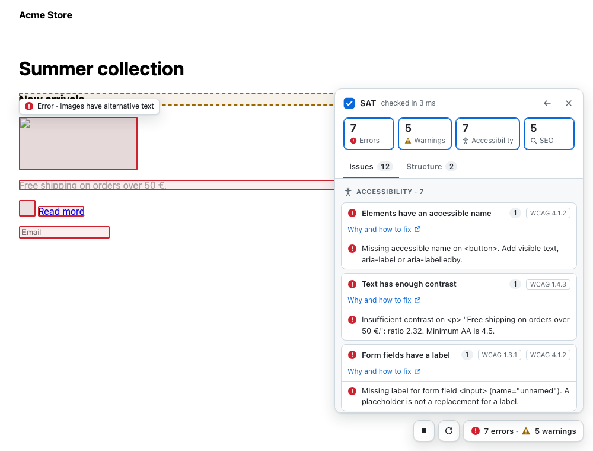

# SEO Accessibility Tool (SAT) 🕵️‍♂️ for Developers

An accessibility and SEO validation tool focused on **heading structure best practices** and **universal accessibility compliance**.  
Detects common issues in heading usage (`<h1>`-`<h6>`), ARIA roles, contrast, labels, and more — with a visual UI panel.

---

## 🚀 Features

✅ Framework-agnostic core logic (React, Vue, Svelte, Angular, Vanilla), a Vite plugin and a browser extension  
✅ Validates heading structure, ARIA roles and attributes, names and labels, contrast, target size, tables, forms, media, images, SEO meta tags, canonical, hreflang, Open Graph, JSON-LD and image loading, with the W3C ACT test cases as specification  
✅ Optional axe-core engine for about 90 more accessibility rules  
✅ Injects a floating toggle button to analyze any page  
✅ Results panel in light and dark theme: counters that filter, issues by category and rule with their WCAG criterion or source, a heading map; click an issue to jump to the element  
✅ Never changes your page: highlights are drawn on SAT's own layer  
✅ Fix with AI: copy a ready prompt for any issue, or (Vite plugin, opt-in) let Claude Code fix it in your source and check it is gone  
✅ Follows single-page apps: route changes rerun the checks  
✅ Supports progressive checks via custom options  
✅ Runs in CI: Playwright helper and the `sat-check` command with JSON/HTML reports, limits and a link crawler

---

## 📦 Installation

```bash
npm install seo-accessibility-tool
```

---

## ⚛️ React Integration

```tsx
import { useSATChecker } from "seo-accessibility-tool/react";

function App() {
  useSATChecker(); // Runs SAT when component mounts
  return <div>My App</div>;
}
```

---

## 🧪 Vue 3 Integration

```vue
<script setup lang="ts">
import { useSatChecker } from "seo-accessibility-tool/vue";

useSatChecker(); // Call it directly in setup: SAT starts when the component is mounted
</script>
```

---

## ⚡ Vite plugin

Adds SAT to the pages of `vite dev` without touching the app's code. `vite build` and `vite preview` don't include it.

```ts
// vite.config.ts
import { defineConfig } from "vite";
import { sat } from "seo-accessibility-tool/vite";

export default defineConfig({
  plugins: [sat({ rules: { "link-text": "warning" } })],
});
```

It takes the options that fit in JSON (`rules`, `wcagLevel`, `allowedLinkTexts`, `observeDom`, the 1.x flags), `axe: true` to run axe-core too (install `axe-core`) and `ai: true` for [Fix with AI](#-fix-with-ai). It works with any app Vite serves: Svelte, SvelteKit, Solid, Preact, Vue, React. `vite` is an optional peer dependency (5 or later).

---

## 🧡 Svelte and Angular

No wrapper is needed: `satChecker` starts the panel from the app's entry point.

```ts
// Svelte (or SvelteKit, in a +layout.svelte onMount): with Vite, the plugin above is enough
import { satChecker } from "seo-accessibility-tool/sat-controller";

satChecker(); // starts when NODE_ENV is "development"
```

```ts
// Angular: main.ts
import { isDevMode } from "@angular/core";
import { bootstrapApplication } from "@angular/platform-browser";
import { satChecker } from "seo-accessibility-tool/sat-controller";
import { AppComponent } from "./app/app.component";

bootstrapApplication(AppComponent).then(() => satChecker({ enabled: isDevMode() }));
```

---

## 🧭 Browser extension

Checks any page, a public site included, without installing SAT in a project. Build it and load it unpacked in Chrome or Edge:

```bash
npm install && npm run build
# chrome://extensions → Developer mode → Load unpacked → dist/extension
```

A click on the SAT button in the toolbar adds the panel to the open tab. The extension asks only for `activeTab` and `scripting`: it can read a tab only after its button is clicked there, and nothing leaves the browser. It also works on pages with a strict Content Security Policy.

---

## 🖱️ UI Behavior

<picture>
  <source media="(prefers-color-scheme: dark)" srcset="docs/images/panel-dark.png">
  
</picture>

- The play button runs the checks and becomes a stop button that turns SAT off; the arrow runs them again; the counts button opens the results panel
- **Summary**: errors, warnings, accessibility and SEO counters; each is a toggle button that hides or shows those issues in the list and on the page
- **Issues**: by category, then by rule, rules with errors first. Each rule shows its title, its count, its WCAG criteria (or its source, such as Google, for rules without one) and a link to its page, "Why and how to fix". Messages are visible in the list: the first five per rule, then "Show N more". Click an issue to scroll to the element, focus it (when it can take focus) and flash its box
- **Structure**: the H1–H6 tree of the page, with skipped levels marked; click a heading to jump to it
- Boxes over the page show each issue (red: error, amber dashed: warning). Pointing at a box, or clicking it, shows a tag with the severity and title of its issues. Boxes and tags are drawn in SAT's own layer, so the page's elements, styles and attributes are never changed
- Light and dark theme from the system setting (`prefers-color-scheme`); short transitions, off with `prefers-reduced-motion`
- The arrow in the panel header moves SAT to the other side of the window; the side is remembered in `localStorage`
- The panel lives in a Shadow DOM: the page's CSS doesn't affect it and its CSS doesn't leak into the page
- Single-page apps: when SAT is on, a route change (`pushState`, `replaceState`, back/forward) runs the checks again. Use `observeDom` to rerun them on any DOM change
- **Copy fix prompt** on every issue and **Copy prompt for all** on every rule put a prompt for an AI coding agent in the clipboard (see [Fix with AI](#-fix-with-ai))
- Keyboard: Tab through the dock and the panel, Escape closes the panel and returns focus to the counts button
- The panel passes SAT's own rules and axe-core in both themes (contrast, target size, names), checked in the tests
- SAT stays on across reloads until you stop it (a flag in `localStorage`)
- Runs only when `process.env.NODE_ENV === "development"` (set by Vite, webpack, Next, etc.); the Vite plugin and the browser extension start it anyway

---

## 🤖 Fix with AI

SAT can hand an issue to an AI coding agent, which fixes it in your source code. Two levels:

1. **Copy fix prompt** (everywhere: Vite, React, Vue, vanilla, the browser extension). The button on an issue, or **Copy prompt for all** on a rule, copies a prompt you paste into your agent (Claude Code, Cursor, Copilot…). Where the clipboard is unavailable, the prompt appears selected in a text box. The same prompt comes from the API:

   ```ts
   import { fixPrompt, seoAccessibilityTool } from "seo-accessibility-tool";

   const { issues } = await seoAccessibilityTool();
   const prompt = fixPrompt(issues.filter((issue) => issue.ruleId === "image-alt"), { url: location.href });
   ```

   The prompt has the rule, severity, WCAG criterion or source, the documentation link, the page URL and, for each issue, the message, the selector, the element's HTML (cut to about 2 KB) and, with Vue and Svelte in development, the component file (Svelte with its line). It asks for the smallest fix in the source, not in the DOM, and to say so instead of changing code when the content comes from data or a CMS. Page content is in fenced blocks declared as data, not instructions.

2. **Fix with AI** (Vite plugin only, opt-in): SAT runs [Claude Code](https://code.claude.com) in your project.

   ```ts
   // vite.config.ts
   plugins: [sat({ ai: true })],
   ```

   The panel gets a **Fix with AI** button on every issue and **Fix all with AI** on every rule. SAT starts `claude -p` in the project root with the prompt, shows the agent's last messages (with a button to cancel), lists the files it changed, then checks the page again after Vite's update: **Fixed** if the issues are gone, **Still present** with the agent's summary if not. One fix runs at a time.

   Requirements: Claude Code installed (`claude` in the `PATH`) and signed in. SAT uses your installation and your account: it handles no API keys and no costs.

**What goes to the model.** SAT itself sends nothing anywhere. With **Fix with AI** turned on, Claude Code sends the prompt (which quotes the page as described above) and the files it reads to the model, as it does when you use it directly. Copying a prompt sends nothing: you decide where to paste it.

**Security of the endpoint.** With `ai: true` the dev server answers `POST /__sat/fix` only for connections from this computer, from the dev server's own pages (`Origin`) and with a token created at every start of the dev server and given only to its pages. Claude Code runs with the tools `Read`, `Edit`, `Grep` and `Glob` only: no shell, no web, no MCP servers. `vite build` and `vite preview` contain neither the endpoint nor the token.

**Undo with git.** SAT keeps no copies of your files. It warns when the repository has uncommitted changes and lists the files the agent changed: commit before a fix, and review it with `git diff`.

---

## 🧩 Configuration

Turn rules off or change their severity with `rules`, as in ESLint:

```ts
useSATChecker({
  rules: {
    "color-contrast": "warning", // every issue of the rule becomes a warning
    "landmarks": "off",
    "link-text": "warning",      // rules that are off by default are turned on by a severity
  },
  allowedLinkTexts: ["Read more", "Learn more"],
});
```

| Option             | Description                                                                                      | Default |
|--------------------|--------------------------------------------------------------------------------------------------|---------|
| `rules`            | `{ [ruleId]: "error" \| "warning" \| "off" }`. A severity applies to every issue of that rule   | `{}`    |
| `wcagLevel`        | `"AA"` or `"AAA"`: AAA adds the AAA criteria as warnings (e.g. 1.4.6 contrast)                   | `"AA"`  |
| `allowedLinkTexts` | Link texts `link-text` accepts anyway (case-insensitive)                                         | `[]`    |
| `enabled`          | Controller only: `true` starts SAT without a bundler, `false` never starts it                    | starts when `NODE_ENV === "development"` |
| `observeDom`       | Controller only: while SAT is on, reruns the checks this many ms after the DOM stops changing    | off     |
| `engines`          | Other checkers run with SAT's rules, e.g. `[axe()]` (see below)                                  | `[]`    |

### Rules

Each rule follows an official source, cited on its page in [`docs/rules/`](docs/rules/): WCAG 2.2 and the W3C ACT rules, WAI-ARIA 1.2, the HTML standard, Google Search Central. Requirements are errors, recommendations are warnings, and what the sources call valid is not reported.

| Rule                | Category | Checks                                                                    | Default    | 1.x option |
|---------------------|----------|---------------------------------------------------------------------------|------------|------------|
| `h1`                | seo      | The page has an `<h1>` (several are valid)                                | warning    | `enableCheckH1` |
| `h1-visible`        | seo      | The first `<h1>` is rendered (not hidden)                                 | warning    | `enableCheckH1Visible` |
| `heading-order`     | a11y     | The first heading of the page is an `<h1>`                                | warning    | `enableCheckHeadingOrder` |
| `heading-levels`    | a11y     | Skipped heading levels (e.g. H2 → H4)                                     | warning    | `enableCheckJumpLevels` |
| `accessible-name`   | a11y     | Buttons, links, menu items, `<summary>`, headings, `svg[role="img"]` and `<object>` have an accessible name | error | `enableCheckAriaLabel` |
| `aria-roles`        | a11y     | Invalid `role` values (error), redundant roles (warning)                  | error      | `enableCheckAriaRolesWithSuggestions` |
| `aria-attributes`   | a11y     | Unknown `aria-*` attributes, invalid values, missing required states, attributes the role doesn't support or prohibits | error | — |
| `aria-hidden-focus` | a11y     | Elements reachable with Tab inside `aria-hidden="true"`                   | error      | — |
| `landmarks`         | a11y     | Several visible `<main>` (error); no main, several page-level header/footer, unlabelled repeated navs (warning) | error | `enableCheckUniqueLandmarks` |
| `color-contrast`    | a11y     | WCAG text contrast: below AA (error), below AAA with `wcagLevel: "AAA"` (warning) | error | `enableCheckTextElementContrast` |
| `form-label`        | a11y     | Form fields have a label (placeholder is not enough)                      | error      | `enableCheckInputLabel` |
| `focus-management`  | a11y     | Hidden focusable elements (error), positive tabindex and non-interactive tab stops (warning) | error | `enableCheckFocusManagement` |
| `image-alt`         | a11y     | `` without `alt` (error), alt text that looks like a file name (warning) | error  | `enableCheckImageAlt` |
| `link-href`         | a11y     | `href=""`, `#` or `javascript:`                                           | error      | `enableCheckEmptyLinks` |
| `link-target-blank` | seo      | `target="_blank"` with `rel="opener"` (HTML already implies noopener)    | off        | `enableCheckExternalLinksRel` |
| `tabindex-negative` | a11y     | Visible native controls removed from the tab order with `tabindex="-1"`   | warning    | `enableCheckTabindexNegativeOne` |
| `link-text`         | a11y     | Vague link texts ("click here", "more")                                    | off        | `enableCheckNonDescriptiveLinks` |
| `html-lang`         | a11y     | `<html>` has a `lang`; every `lang` is a valid language tag               | error      | `enableCheckHtmlLang` |
| `iframe-name`       | a11y     | `<iframe>` has a `title`, `aria-label` or `aria-labelledby`               | error      | — |
| `label-in-name`     | a11y     | The visible label of a button or link is part of its `aria-label`         | error      | — |
| `target-size`       | a11y     | Targets under 24×24 px too close to other targets (WCAG 2.2, browser only) | error     | — |
| `autocomplete-valid`| a11y     | `autocomplete` values follow the HTML autofill tokens                     | error      | — |
| `table-headers`     | a11y     | `headers` pointing outside the table, header cells without cells          | error      | — |
| `meta-viewport`     | a11y     | `user-scalable=no` or `maximum-scale` below 2 (zoom blocked)              | error      | — |
| `meta-refresh`      | a11y     | `<meta http-equiv="refresh">` with a delay (1 s to 20 h)                  | error      | — |
| `media-autoplay`    | a11y     | `<video>`/`<audio>` that autoplay with sound and no controls              | warning    | — |
| `seo-meta`          | seo      | One `<title>` and one meta description (error), meta viewport (warning); no length limits | error | `enableCheckSeoMeta` |
| `canonical`         | seo      | Several or empty canonicals (error), missing or relative canonical (warning) | warning   | — |
| `robots-meta`       | seo      | `noindex`, `nofollow` or `none` in a robots meta tag                      | warning    | — |
| `social-meta`       | seo      | Required Open Graph properties, absolute `og:image`/`og:url`, `twitter:card` | warning | — |
| `hreflang`          | seo      | Invalid language codes, relative URLs, one language with two URLs         | error      | — |
| `structured-data`   | seo      | JSON-LD that doesn't parse, items without `@type`, properties Google requires for rich results (Product, Event, Breadcrumb…) | error | — |
| `mixed-content`     | seo      | `http:` resources on an `https:` page: scripts, frames, styles (error), images and media (warning) | error | — |
| `image-size`        | seo      | Visible `` without `width` and `height` (layout shift)               | warning    | — |
| `image-lazy-load`   | seo      | `loading="lazy"` on images visible when the page opens                    | warning    | — |
| `link-broken`       | seo      | HEAD request to each internal link to find 4xx/5xx (skips logout-like URLs); `sat-check --depth` finds SPA 404s too | off | `enableCheckBrokenInternalLinks` |

Each rule has a page in [docs/rules](docs/rules) on what it checks, why and how to fix it; the panel links to it from every rule, and each issue has its URL in `help`, the rule's readable name in `title` and, for rules without a WCAG criterion, its source in `source`.

The 1.x options `enableCheck*` still work (`true` turns the rule on, `false` off) but are deprecated; `rules` takes precedence.

---

## ♿ axe-core engine (optional)

[axe-core](https://github.com/dequelabs/axe-core) checks about 90 accessibility rules. Install it and pass the engine:

```bash
npm install -D axe-core
```

```ts
import { satChecker } from "seo-accessibility-tool/sat-controller";
import { axe } from "seo-accessibility-tool/axe";

satChecker({ engines: [axe()] });
```

- axe's violations appear in the panel as `axe/<rule>` (e.g. `axe/image-alt`), with a link to Deque's page on the rule. Critical and serious ones are errors, the others warnings; results axe can't decide are not shown.
- The SAT rules axe covers are off while it runs, so a problem is reported once: `accessible-name`, `aria-roles`, `aria-attributes`, `aria-hidden-focus`, `landmarks`, `color-contrast`, `form-label`, `focus-management`, `image-alt`, `html-lang`, `heading-levels`, `iframe-name`, `label-in-name`, `autocomplete-valid`, `table-headers`, `meta-viewport`, `meta-refresh`, `media-autoplay`. `target-size` stays on: axe's own rule is off by default. Setting one in `rules` turns it back on.
- `rules` sets axe rules too: `rules: { "axe/region": "off" }`. `axe(options)` takes axe's run options, e.g. `axe({ runOnly: ["wcag2a", "wcag2aa"] })`.
- axe adds about 550 KB (150 KB gzipped) and makes a run slower: 0.1–1.5 s instead of 5–50 ms on real pages. It checks the page's own document only.

With React or Vue pass the same option: `useSATChecker({ engines: [axe()] })`.

---

## 🔎 Results without the panel

```ts
import { seoAccessibilityTool } from "seo-accessibility-tool";

const { issues, errors, warnings } = await seoAccessibilityTool({ rules: { "link-text": "warning" } });
// issues: [{ ruleId, severity, category, message, title?, wcag?, source?, element?, selector?, help? }]
```

The page is not changed. `selector` matches only the element of the issue. `satReset` is deprecated and does nothing. `errorMessages` and `warningMessages` (lists of strings) are still returned but deprecated.

`runSAT(options?, document?)` runs the same checks and returns plain data, ready for `JSON.stringify` (no DOM nodes):

```ts
import { runSAT } from "seo-accessibility-tool";

const { issues, summary } = await runSAT();
// issues: [{ ruleId, severity, category, message, title?, wcag?, source?, selector?, help? }], summary: { errors, warnings }
```

---

## 🎭 Playwright

`seo-accessibility-tool/playwright` checks a page in your end-to-end tests. The page doesn't need to import SAT: the helper adds it for the run. `@playwright/test` is an optional peer dependency.

```ts
import { test } from "@playwright/test";
import { checkPage, expect } from "seo-accessibility-tool/playwright";

test("home has no SAT errors", async ({ page }) => {
  await page.goto("/");
  await expect(page).toHaveNoSATErrors(); // fails with the list of errors: rule, message, selector
});

test("report", async ({ page }) => {
  await page.goto("/");
  const { issues, summary } = await checkPage(page, { rules: { "social-meta": "off" }, axe: true });
});
```

- Both take the SAT options that can cross into the page (`rules`, `wcagLevel`, `allowedLinkTexts`, the 1.x flags) and `axe: true` to run axe-core too (install `axe-core`).
- `expect` is Playwright's own, extended: use it in place of the one from `@playwright/test`, or merge it with yours through `mergeExpects`.
- Pages with a strict Content Security Policy block the added script: create the context with `bypassCSP: true`.

---

## 🧪 CLI and CI

```bash
npm install -D seo-accessibility-tool @playwright/test
npx playwright install chromium
npx sat-check http://localhost:5173/ http://localhost:5173/pricing
```

| Option | Default | Meaning |
|--------|---------|---------|
| `--max-errors <n>` | `0` | Errors allowed over all pages; above it the exit code is 1 |
| `--max-warnings <n>` | no limit | Warnings allowed over all pages |
| `--json <file>` | — | Writes `{ pages: [{ url, issues, summary }], summary }` |
| `--html <file>` | — | Writes a standalone HTML report |
| `--config <file>` | — | JSON with SAT options, e.g. `{ "rules": { "link-text": "warning" } }` |
| `--axe` | off | Runs axe-core too (install `axe-core`) |
| `--wcag-level <level>` | `AA` | `AAA` adds the AAA criteria as warnings |
| `--depth <n>` | `0` | Follows same-origin links this many levels deep, checks those pages and reports broken links |
| `--max-pages <n>` | `100` | Stops after this many pages |
| `--not-found <text>` | — | A page showing this text is a broken link: the "not found" view of a single-page app |

Exit codes: 0 within the limits, 1 above them, 2 for a wrong command or a run that couldn't start.

**Broken links.** With `--depth` every link is opened in Chromium, so a single-page app resolves the route with its own router. A link is broken when the server answers 4xx/5xx, the navigation fails, or the page shows the `--not-found` text; it is reported as `link-broken` on the page that links to it. Logout, delete and similar URLs are never opened. Set its severity or turn it off with `rules` in `--config`; the in-page `link-broken` rule (HEAD requests) doesn't run in the CLI.

**GitHub Actions:**

```yaml
name: SAT
on: [pull_request]
jobs:
  sat:
    runs-on: ubuntu-latest
    steps:
      - uses: actions/checkout@v7
      - uses: actions/setup-node@v7
        with: { node-version: 22, cache: npm }
      - run: npm ci
      - run: npx playwright install --with-deps chromium
      - run: npm run build && (npx vite preview --port 4173 &) && curl -s --retry 10 --retry-connrefused -o /dev/null http://localhost:4173/
      - run: npx sat-check http://localhost:4173/ --depth 2 --not-found "Page not found" --max-warnings 20 --html sat-report.html
      - uses: actions/upload-artifact@v7
        if: always()
        with: { name: sat-report, path: sat-report.html }
```

---

## 🛠️ Development

```bash
npm install
npm run verify       # type check, lint, unit tests, build
npm run verify:e2e   # build + browser tests (Chromium)
```

- Conventions: [CONVENTIONS.md](CONVENTIONS.md); agent rules: [AGENTS.md](AGENTS.md)
- Roadmap and backlog by phase: [plan/README.md](plan/README.md)
- Changes: [CHANGELOG.md](CHANGELOG.md)

---

## 📄 License

MIT License © 2025 [Giulio Simone Floresta](https://github.com/flgisimone)

---

## 🔗 References

- [WCAG 2.1 Guidelines](https://www.w3.org/TR/WCAG21/)
- [WAI-ARIA Authoring Practices](https://www.w3.org/WAI/ARIA/apg/)
